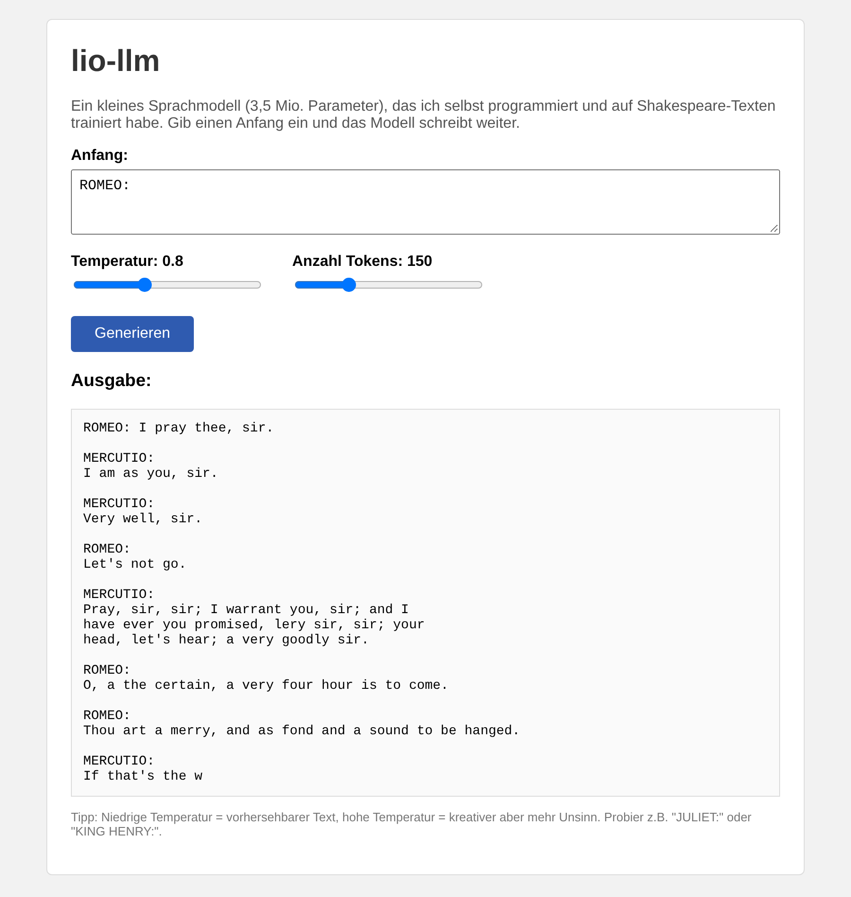

# lio-llm

Ein kleines Sprachmodell (GPT-artig), das ich von Grund auf in PyTorch programmiert habe.

Ich wollte verstehen, wie Modelle wie ChatGPT eigentlich intern funktionieren, und nicht nur
fertige Bibliotheken benutzen. Deshalb habe ich alles selbst geschrieben: den Tokenizer, das
Transformer-Modell, das Training und die Textgenerierung. Als Datensatz habe ich Tiny Shakespeare
benutzt (ca. 1 MB Text), weil man damit auch ohne GPU in vernünftiger Zeit trainieren kann.



## Was ich umgesetzt habe

- BPE-Tokenizer auf Byte-Ebene (ähnlich wie bei GPT-2)
- Transformer (nur Decoder) mit Self-Attention, RoPE, RMSNorm und SwiGLU.
  Die letzten drei habe ich mir aus dem LLaMA-Paper abgeschaut
- KV-Cache zum schnelleren Generieren, dazu Temperatur, Top-k und Top-p Sampling
- Training mit AdamW, Warmup und Cosine Learning Rate
- eine kleine Weboberfläche mit Flask
- ein paar Tests mit pytest

## Ordnerstruktur

- `liollm/tokenizer.py` - der Tokenizer
- `liollm/model.py` - das Modell
- `data/prepare.py` - Daten laden und Tokenizer trainieren
- `train.py` - Training
- `generate.py` - Text generieren
- `app.py` - Weboberfläche

## Benutzung

Pakete installieren:

```bash
pip install -r requirements.txt
```

Daten vorbereiten (lädt Tiny Shakespeare herunter und trainiert den Tokenizer):

```bash
python data/prepare.py
```

Modell trainieren (bei mir ca. 15 Minuten auf der CPU):

```bash
python train.py --n-layer 4 --n-head 4 --n-embd 256 --block-size 128 --max-iters 2000 --lr 2e-3
```

Text generieren:

```bash
python generate.py --prompt "ROMEO:"
```

Oder die Weboberfläche starten und http://localhost:5000 im Browser öffnen:

```bash
python app.py
```

## Ergebnisse

Das Modell hat 3,5 Millionen Parameter (4 Layer, 4 Attention-Heads, Embedding-Größe 256) und
ein Vokabular von 1024 Tokens.

| Iteration | Train Loss | Val Loss |
|---|---|---|
| 0 | 6.98 | 6.99 |
| 500 | 3.19 | 3.81 |
| 1000 | 2.71 | 3.71 |
| 2000 | 2.11 | 3.79 |

Ab ungefähr Iteration 1000 wird der Validation Loss wieder schlechter, während der Training Loss
weiter sinkt. Das Modell fängt also an, den Trainingstext auswendig zu lernen (Overfitting).
Deshalb speichert das Trainingsskript immer nur das Modell mit dem besten Validation Loss.
Mit mehr Daten oder mehr Dropout könnte man das wahrscheinlich noch verbessern.

Beispiel-Ausgabe:

```
ROMEO: O, villain, go home.

MERCUTIO:
Nay, I should yield you.

BENVOLIO:
Do you so often. O, what's the news?
```

Der Text ergibt natürlich nicht wirklich Sinn, aber das Modell hat die Struktur gelernt
(Namen der Sprecher, Zeilenumbrüche, alter Englisch-Stil). Für 3,5 Mio. Parameter finde ich das
ziemlich gut.

## Probleme / Notizen

- Das Tokenizer-Training ist schneller, wenn man jedes Wort nur einmal zählt und mit seiner
  Häufigkeit gewichtet, statt jedes Mal über den ganzen Text zu gehen. So dauert es ca. 25 Sekunden.
- `view()` hat beim Berechnen des Loss einen Fehler geworfen, weil der Tensor nicht contiguous
  war. Mit `reshape()` geht es.
- RoPE kann man sich als Drehung von 2D-Vektoren vorstellen, damit wird es verständlicher.
- Beim KV-Cache muss man aufpassen, dass die Positionen (für RoPE) richtig weitergezählt werden.
  Dafür habe ich einen Test geschrieben, der die Ausgabe mit und ohne Cache vergleicht.

## Tests

```bash
pytest
```

Die Tests prüfen z.B. ob das Modell nicht in die Zukunft schaut und ob der KV-Cache das gleiche
rauskommt wie ohne Cache.

## Was ich als Nächstes machen möchte

- auf einem deutschen Datensatz trainieren
- Modell auf einer GPU mit mehr Parametern trainieren
- Grouped-Query-Attention ausprobieren

## Quellen

- Vaswani et al., "Attention Is All You Need" (2017)
- Andrej Karpathy, nanoGPT und die YouTube-Reihe "Neural Networks: Zero to Hero"
- Su et al., "RoFormer: Enhanced Transformer with Rotary Position Embedding" (2021)
- Touvron et al., "LLaMA: Open and Efficient Foundation Language Models" (2023)
